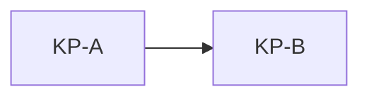

# Copy button test

For each row, note whether a copy button appears on hover, and how the box sits in the cell.

## 1. Fenced block inside rp

KB fence inside an rp inside a cell. Hypothesis: the block and its copy button are hidden.

<table>
<tr><td><rp>

```
KB-in-rp-text
```

</rp>

</td></tr>
</table>

END KB

## 2. Hand-written HTML that imitates GitHub's block

<table>
<tr><td>KA control fence</td><td>

```
KA-control-text
```

</td></tr>
<tr><td>KC raw pre</td><td><pre>KC-raw-pre</pre></td></tr>
<tr><td>KD pre and code</td><td><pre><code>KD-pre-code</code></pre></td></tr>
<tr><td>KE highlight div</td><td><div class="highlight"><pre>KE-highlight-div</pre></div></td></tr>
<tr><td>KF snippet div</td><td><div class="snippet-clipboard-content notranslate position-relative overflow-auto"><pre class="notranslate"><code>KF-snippet-div</code></pre></div></td></tr>
<tr><td>KG clipboard-copy element</td><td><clipboard-copy value="KG-value" aria-label="Copy">KG-label</clipboard-copy></td></tr>
<tr><td>KH button</td><td><button>KH-button</button></td></tr>
<tr><td>KI zeroclipboard container</td><td><div class="zeroclipboard-container"><clipboard-copy for="x">KI-zero</clipboard-copy></div></td></tr>
</table>

## 3. Other kinds of block (which get a copy button)

<table>
<tr><td>KJ text language</td><td>

```text
KJ-text-lang
```

</td></tr>
<tr><td>KK diff</td><td>

```diff
+ KK-diff-line
```

</td></tr>
<tr><td>KL four backticks</td><td>

````
KL-four-backticks
````

</td></tr>
<tr><td>KM tildes</td><td>

~~~
KM-tildes
~~~

</td></tr>
<tr><td>KN indented code</td><td>

    KN-indented-code

</td></tr>
<tr><td>KO inline code</td><td>

`KO-inline-code`

</td></tr>
<tr><td>KP mermaid</td><td>



</td></tr>
<tr><td>KQ math block</td><td>

```math
KQ = x^2
```

</td></tr>
<tr><td>KR suggestion</td><td>

```suggestion
KR-suggestion
```

</td></tr>
</table>

## 4. Ways to change the space around the box

<table>
<tr><td>KS fence inside a blockquote</td><td>

> ```
> KS-in-blockquote
> ```

</td></tr>
<tr><td>KT fence inside a list item</td><td>

- ```
  KT-in-list
  ```

</td></tr>
<tr><td>KU fence inside details</td><td>

<details><summary>open</summary>

```
KU-in-details
```

</details>

</td></tr>
<tr><td>KV fence inside a nested table cell</td><td><table><tr><td>

```
KV-in-nested-cell
```

</td></tr></table></td></tr>
<tr><td>KW fence in a centered div</td><td><div align="center">

```
KW-centered
```

</div></td></tr>
<tr><td>KX fence with blank lines inside</td><td>

```

KX-blank-lines

```

</td></tr>
<tr><td>KY fence with spaces before text</td><td>

```
    KY-leading-spaces
```

</td></tr>
<tr><td>KZ table with cellpadding 20</td><td><table cellpadding="20"><tr><td>

```
KZ-cellpadding
```

</td></tr></table></td></tr>
</table>
